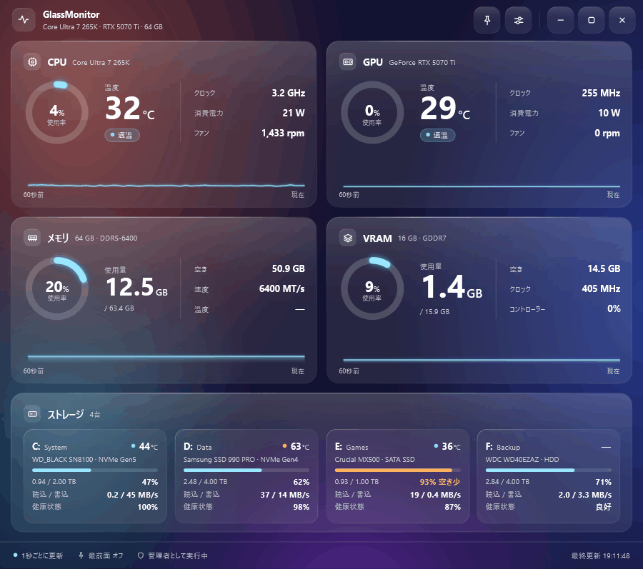
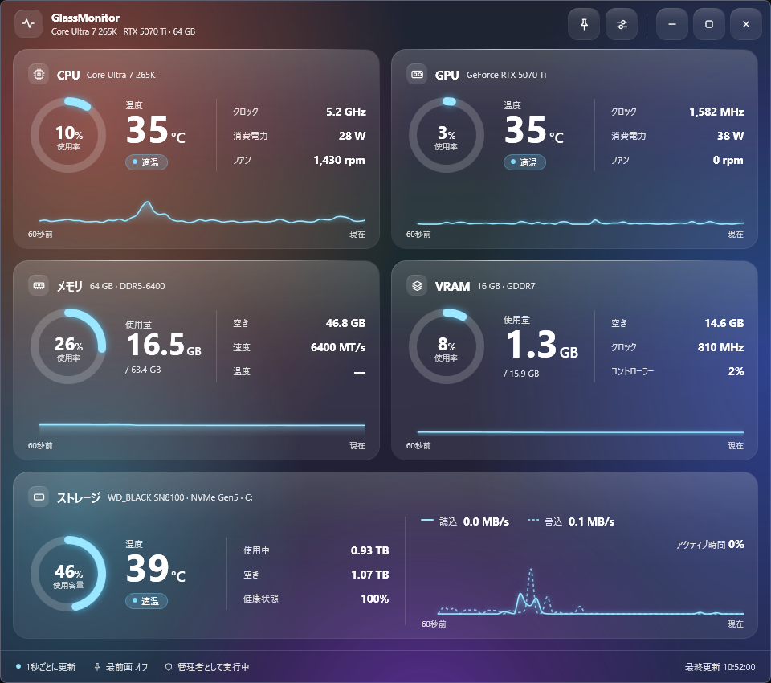
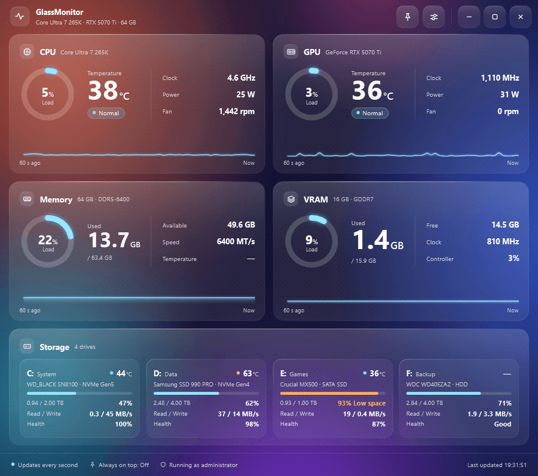
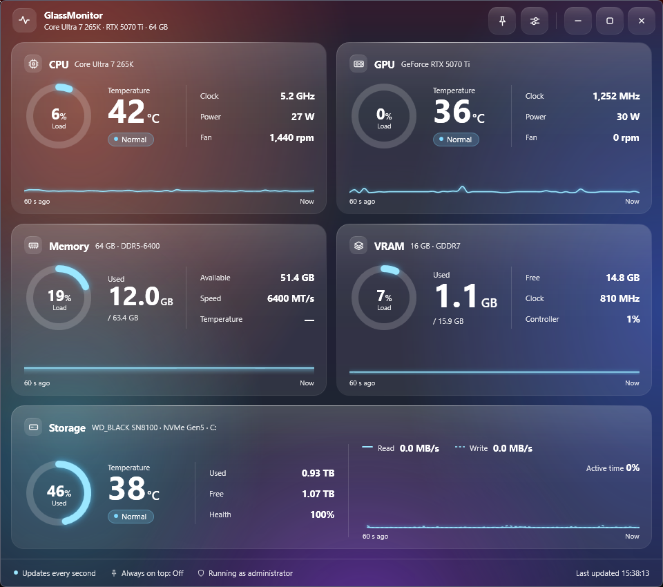

# GlassMonitor

[](https://github.com/taki3100/GlassMonitor/releases)
[](https://github.com/taki3100/GlassMonitor/releases)
[](LICENSE)

A hardware monitor for Windows with a glassmorphism-style UI — CPU, GPU, memory, VRAM and storage at a glance.
グラスモーフィズム風のデザインで、CPU・GPU・メモリ・VRAM・ストレージを一画面で確認できる、Windows向けのハードウェアモニターです。

**[日本語](#日本語)** | **[English](#english)** | [Code signing policy](CODE_SIGNING_POLICY.md) | [Contributing](CONTRIBUTING.md)

---

## 日本語



**[最新版をダウンロード](https://github.com/taki3100/GlassMonitor/releases)**（Windows 11 x64 用の zip。展開して `GlassMonitor.exe` を実行します。[詳しい手順](#ダウンロードと起動)）

- **一画面ですべて確認**：CPU・GPU・メモリ・VRAM・ストレージの使用率、温度、クロック、消費電力を 1 秒ごとに更新し、直近 60 秒をグラフで表示
- **温度がひと目でわかる**：色と「適温 / 高め / 高温」で表示（しきい値は変更可）。ストレージは健康状態と読み書き速度も表示
- **グラスモーフィズム風の UI**：Windows 11 の Acrylic 背景、アクセント色、常に最前面。日本語・英語に対応

**安心して使うために**

- オープンソースです（[MIT License](LICENSE)）。ソースコードはすべてこのリポジトリで公開しています
- ネットワークに接続せず、データを収集・送信しません（[プライバシーポリシー](CODE_SIGNING_POLICY.md#プライバシーポリシー)）
- VirusTotal で検出 0 件です（[v0.2.0 の GlassMonitor.dll の検査結果](https://www.virustotal.com/gui/file/38a49cc7b64a1d1a7d58819bf5230005f654076af11ba2ee726ae68279865511)）

> [!NOTE]
> リリースはコード署名をしていないため、初回起動時に SmartScreen の警告（「Windows によって PC が保護されました」）が表示されることがあります。[表示されたときの対処方法](#smartscreen-の警告が出た場合)

### 機能の詳細



| タイル | 表示内容 |
|---|---|
| CPU | 使用率、温度、クロック、消費電力、CPU ファン回転数 |
| GPU | 使用率、温度、コアクロック、消費電力、ファン回転数 |
| メモリ | 使用率、使用量 / 総容量、空き、速度。温度（任意、既定 OFF） |
| VRAM | 使用量 / 総容量、空き、メモリクロック、メモリコントローラー負荷 |
| ストレージ | 物理ディスクを最大 4 台表示。1 台なら詳細表示（使用容量、温度、使用中 / 空き、健康状態、読込・書込速度の 2 本線グラフ、アクティブ時間）、2〜4 台なら台数で等分したカード表示（ドライブ文字とボリュームラベル、型番と種類、温度、容量バー、読込 / 書込、健康状態） |

- ストレージは物理ディスク単位で表示し、パーティションが複数あればドライブ文字を並べます（例：`D: E:`）。空き容量が 10% 未満になると容量バーがオレンジになり「空き少」と表示します。健康状態は SSD なら寿命（%）、寿命の取れない HDD などは SMART の状態（良好 / 注意）です。5 台以上あるときは、表示する 4 台を設定で選べます
- USB メモリなど、一部の外付けドライブは表示されません
- 1 秒ごとに更新し、直近 60 秒をグラフで表示
- 温度は色と文字（適温 / 高め / 高温）で表示。しきい値は「CPU・GPU・メモリ」と「SSD」で別々に設定できます
- 取得できないセンサーは「—」と表示
- 常に最前面、アクセント色の変更、ウィンドウの位置とサイズの保存
- サインイン時の自動起動（任意）
- Windows 11 の Acrylic 背景

画面は日本語と英語に対応しています。既定では Windows の表示言語に合わせ（日本語なら日本語、それ以外は英語）、設定で切り替えることもできます。ほかの言語への翻訳も歓迎します（[CONTRIBUTING.md](CONTRIBUTING.md#翻訳)）。

### 動作環境

- Windows 11 x64（22H2 以降を推奨。それより前の Windows では背景が単色になります）
- 管理者権限（起動時に UAC の確認が表示されます）
- [PawnIO](https://pawnio.eu/)（CPU 温度などの取得に必要。[導入方法](#pawnio-の導入)）
- .NET のインストールは不要です（ランタイム同梱）

### ダウンロードと起動

1. [Releases](https://github.com/taki3100/GlassMonitor/releases) から `GlassMonitor-x.y.z-win-x64.zip` をダウンロードします。
2. （推奨）ファイルが改ざんされていないか確認します。PowerShell で次を実行し、Releases にある `.sha256` の値と一致することを確かめてください。
   ```powershell
   Get-FileHash .\GlassMonitor-x.y.z-win-x64.zip -Algorithm SHA256
   ```
3. zip を展開し、`GlassMonitor\GlassMonitor.exe` を実行します。UAC の確認が出たら「はい」を選びます。

### PawnIO の導入

GlassMonitor は、センサーの読み取りに [LibreHardwareMonitor](https://github.com/LibreHardwareMonitor/LibreHardwareMonitor) のライブラリを使います。CPU の温度・クロック・消費電力やマザーボードのファン回転数を読むには、LibreHardwareMonitor が利用するオープンソースのドライバー **PawnIO** が必要です。

PawnIO が無い場合や、アンチチートなどにブロックされて使えない場合でも GlassMonitor は起動し、**CPU センサー制限モード**で動作します。PawnIO が必要な項目だけが「—」になり、ステータスバーに「CPUセンサー制限モード」と PawnIO の導入方法へのリンクが表示されます。PawnIO が未インストールのときは起動時に案内画面も表示されます（案内画面で次回から表示しないようにできます）。

**方法 1：インストーラー**

1. [pawnio.eu](https://pawnio.eu/) または [GitHub のリリース](https://github.com/namazso/PawnIO.Setup/releases/latest) から `PawnIO_setup.exe` をダウンロードします。
2. 実行して画面の指示に従います。

**方法 2：winget**

```powershell
winget install --id namazso.PawnIO --exact
```

インストールが終わったら GlassMonitor を再起動してください。

| PawnIO が無くても表示できる | PawnIO が必要 |
|---|---|
| CPU 使用率、GPU のすべて、メモリ使用量・速度、VRAM、ストレージ | CPU の温度・クロック・消費電力、CPU ファン回転数、メモリ温度 |

### SmartScreen の警告が出た場合

コード署名の無いリリースや、公開されて間もないリリースでは、初回起動時に「Windows によって PC が保護されました」と表示されることがあります。

1. ファイルが[公式のリリースページ](https://github.com/taki3100/GlassMonitor/releases)から入手したものか確認し、上記の手順で SHA-256 を照合します。
2. 警告画面の「**詳細情報**」をクリックし、「**実行**」を選びます。

zip を展開する前にブロックを解除しておく方法もあります。zip ファイルを右クリック →「プロパティ」→「全般」タブ下部の「セキュリティ」で「**許可する**」にチェック →「OK」の順に操作してから展開してください。

### 使い方

- タイトルバーをドラッグして移動します。右上のボタンは左から「常に最前面」「設定」「最小化」「最大化」「閉じる」です。
- 「設定」では次の項目を変更できます。
  - 表示言語（自動 / 日本語 / English。「自動」は Windows の表示言語が日本語なら日本語、それ以外は英語）
  - アクセント色（見本から選ぶか `#RRGGBB` で入力して Enter）
  - 温度のしきい値（この温度以上で「高め」「高温」。CPU・GPU・メモリと SSD で別々）
  - 常に最前面 / サインイン時に自動起動 / 背景のグロー / メモリ温度（SPD）
  - 表示するドライブ（物理ディスクが 5 台以上あるときだけ表示。最大 4 台）
- 設定画面のいちばん下に、GlassMonitor と PawnIO のバージョンが表示されます。
- 設定は `%APPDATA%\GlassMonitor\settings.json` に保存されます。

### メモリ温度と iCUE などのツールについて

メモリ温度は、SMBus 経由で DIMM の SPD を読み取って取得します。Corsair iCUE などのメモリのライティングを制御するソフトも SMBus を使うため、同時にアクセスすると競合するおそれがあります。そのため**既定は OFF** にしています。OFF の間、GlassMonitor は SMBus に一切アクセスせず、メモリタイルには温度の代わりに使用量を大きく表示します。

GlassMonitor はファンの制御やライティングの制御を行いません。USB の HID デバイス（ファンコントローラー、簡易水冷、電源など）にもアクセスしません（LibreHardwareMonitor の Controller・PSU・Network・Battery 機能は無効にしています）。

### アンチチートとの互換性

GlassMonitor は、ゲームのプロセスに触れません（他プロセスのメモリの読み書き、DLL 注入、フック、ゲーム画面へのオーバーレイ描画はしません）。ただし、CPU などのセンサーを読むためにカーネルドライバー PawnIO を使うため、アンチチートによっては PawnIO がブロックされることがあります。点検の詳細は [docs/ANTICHEAT_CHECK.md](docs/ANTICHEAT_CHECK.md) を参照してください。

| アンチチート | 状況 |
|---|---|
| Tencent ACE（Arknights: Endfield） | **動作確認済み**。起動から約 1 時間プレイして問題なし（確認日 2026-10-15、GlassMonitor 0.1.1、PawnIO 2.2.0） |
| FACEIT | **非対応**。FACEIT は PawnIO をブロックします（FACEIT サポートの説明では、PawnIO の署名証明書がチートソフトの署名にも使われていたため）。GlassMonitor は CPU センサー制限モードで動作します |
| Easy Anti-Cheat、BattlEye、Riot Vanguard など、その他のアンチチート | **未検証** |

動作報告を募集しています。[アンチチート互換性の報告](https://github.com/taki3100/GlassMonitor/issues/new?template=anticheat-compatibility.yml)から、ゲーム名、アンチチート名、結果、GlassMonitor と PawnIO のバージョン、起動した順番を教えてください。

### サインイン時の自動起動

設定で「サインイン時に自動起動」を ON にすると、確認ダイアログのあと、タスク スケジューラに `GlassMonitor` というタスクを登録します。GlassMonitor は管理者権限が必要なため、「最上位の特権で実行」として登録します（サインイン時に UAC の確認は出ません）。OFF にするとタスクを削除します。アプリのフォルダーを移動した場合は、もう一度 ON にしてください。

### アンインストール

1. 自動起動を ON にしている場合は、設定で OFF にします（またはタスク スケジューラで `GlassMonitor` タスクを削除します）。
2. GlassMonitor を終了し、展開したフォルダーを削除します。
3. 設定とログを削除します：`%APPDATA%\GlassMonitor`、`%LOCALAPPDATA%\GlassMonitor`
4. PawnIO が不要になった場合は、「設定」→「アプリ」→「インストールされているアプリ」からアンインストールします（他のツールが PawnIO を使っている場合は残してください）。

### ビルド

必要なもの：Windows 10 / 11 x64、[.NET SDK 10.0](https://dotnet.microsoft.com/download/dotnet/10.0)

```powershell
git clone https://github.com/taki3100/GlassMonitor.git
cd GlassMonitor
dotnet build GlassMonitor.slnx -c Release
```

`GlassMonitor\bin\Release\net10.0-windows\GlassMonitor.exe` を実行します（管理者権限が必要なため UAC の確認が出ます。Visual Studio からデバッグする場合は、Visual Studio を管理者として起動してください）。

配布用と同じ self-contained ビルドを作るには次を実行します。

```powershell
dotnet publish GlassMonitor/GlassMonitor.csproj -c Release -r win-x64 --self-contained true -p:Version=0.2.0 -o publish/GlassMonitor
```

リリースは `v1.2.3` 形式のタグを push すると、GitHub Actions（[release.yml](.github/workflows/release.yml)）がビルドして zip を Releases に公開します。

### プライバシー

GlassMonitor はネットワークに接続せず、データを収集・送信しません。詳しくは [コード署名ポリシー](CODE_SIGNING_POLICY.md#プライバシーポリシー) を参照してください。

### コード署名ポリシー（Code signing policy）

現在のリリースはコード署名されていません。

将来コード署名する場合の方針（署名の対象・役割）とプライバシーポリシーは [CODE_SIGNING_POLICY.md](CODE_SIGNING_POLICY.md) を参照してください。

### ライセンス

[MIT License](LICENSE)。同梱しているサードパーティ製コンポーネントのライセンスは [THIRD-PARTY-NOTICES.md](THIRD-PARTY-NOTICES.md) を参照してください。

コミュニティでの行動については [行動規範](CODE_OF_CONDUCT.md) を参照してください。

---

## English



**[Download the latest release](https://github.com/taki3100/GlassMonitor/releases)** (a zip for Windows 11 x64: extract it and run `GlassMonitor.exe`. [Details](#download-and-run))

- **Everything on one screen**: load, temperature, clock and power of the CPU, GPU, memory, VRAM and storage, updated every second with a 60-second graph
- **Temperatures at a glance**: shown with color and a label (normal / warm / hot) using thresholds you can change. Storage also shows health and read / write speed
- **Glassmorphism-style UI**: Acrylic background on Windows 11, custom accent color, always on top. English and Japanese

**Peace of mind**

- Open source ([MIT License](LICENSE)). All of the source code is in this repository
- No network connections; no data is collected or sent ([privacy policy](CODE_SIGNING_POLICY.md#privacy-policy))
- 0 detections on VirusTotal ([scan of GlassMonitor.dll in v0.2.0](https://www.virustotal.com/gui/file/38a49cc7b64a1d1a7d58819bf5230005f654076af11ba2ee726ae68279865511))

> [!NOTE]
> Releases are not code signed, so Windows SmartScreen may show "Windows protected your PC" on the first start. [What to do](#if-smartscreen-shows-a-warning)

### Features in detail



| Tile | What it shows |
|---|---|
| CPU | Load, temperature, clock, package power, CPU fan speed |
| GPU | Load, temperature, core clock, power, fan speed |
| Memory | Load, used / total, available, speed. Temperature (optional, off by default) |
| VRAM | Used / total, free, memory clock, memory controller load |
| Storage | Up to 4 physical disks. With one disk: detailed view (used space, temperature, used / free, health, read & write throughput as a two-line graph, active time). With 2–4 disks: equally sized cards (drive letters and volume label, model and type, temperature, capacity bar, read / write, health) |

- Storage is shown per physical disk; disks with several partitions list all drive letters (e.g. `D: E:`). When free space drops below 10%, the capacity bar turns orange and shows "Low space". Health is the remaining life (%) for SSDs and the SMART status (good / caution) for HDDs and other drives without a life value. With 5 or more disks, you choose which 4 to show in the settings
- Some external drives, such as USB flash drives, are not shown
- Updates every second with a 60-second history graph
- Temperatures are shown with color and a label (normal / warm / hot). Thresholds can be set separately for CPU/GPU/memory and for SSDs
- Sensors that cannot be read are shown as "—"
- Always on top, custom accent color, remembers window position and size
- Optional start at sign-in
- Acrylic background on Windows 11

The user interface is available in English and Japanese. By default it follows the Windows display language (Japanese if Windows is in Japanese, English otherwise), and you can change it in the settings. Translations into other languages are welcome — see [CONTRIBUTING.md](CONTRIBUTING.md#translations).

### Requirements

- Windows 11 x64 (22H2 or later recommended; on older versions the background is solid)
- Administrator rights (a UAC prompt appears on start)
- [PawnIO](https://pawnio.eu/) for CPU temperature and other low-level sensors ([how to install](#installing-pawnio))
- No separate .NET installation is needed (the runtime is included)

### Download and run

1. Download `GlassMonitor-x.y.z-win-x64.zip` from [Releases](https://github.com/taki3100/GlassMonitor/releases).
2. (Recommended) Verify the file. Run the following in PowerShell and compare the result with the `.sha256` file on the release page.
   ```powershell
   Get-FileHash .\GlassMonitor-x.y.z-win-x64.zip -Algorithm SHA256
   ```
3. Extract the zip and run `GlassMonitor\GlassMonitor.exe`. Choose "Yes" in the UAC prompt.

### Installing PawnIO

GlassMonitor reads sensors through the [LibreHardwareMonitor](https://github.com/LibreHardwareMonitor/LibreHardwareMonitor) library, which uses the open-source **PawnIO** driver to access CPU temperatures, clocks, power and motherboard fan speeds.

If PawnIO is not installed, or is blocked (for example by an anti-cheat), GlassMonitor still starts and runs in **CPU sensor limited mode**: only the values that need PawnIO are shown as "—", and the status bar shows "CPU sensor limited mode" with a link to the PawnIO installation guide. When PawnIO is not installed, the guide is also shown on start-up (you can turn this off in the guide).

**Option 1: installer**

1. Download `PawnIO_setup.exe` from [pawnio.eu](https://pawnio.eu/) or the [GitHub releases](https://github.com/namazso/PawnIO.Setup/releases/latest).
2. Run it and follow the instructions.

**Option 2: winget**

```powershell
winget install --id namazso.PawnIO --exact
```

Restart GlassMonitor after the installation.

| Works without PawnIO | Requires PawnIO |
|---|---|
| CPU load, all GPU values, memory usage and speed, VRAM, storage | CPU temperature, clock and power, CPU fan speed, memory temperature |

### If SmartScreen shows a warning

Unsigned releases, and recently published releases, may show "Windows protected your PC" on the first start.

1. Make sure the file comes from the [official release page](https://github.com/taki3100/GlassMonitor/releases) and verify its SHA-256 hash as described above.
2. Click "**More info**" in the warning and then "**Run anyway**".

Alternatively, unblock the zip before extracting it: right-click the zip → "Properties" → on the "General" tab, check "**Unblock**" under "Security" → "OK", then extract it.

### Usage

- Drag the title bar to move the window. The buttons at the top right are: always on top, settings, minimize, maximize and close.
- In the settings you can change:
  - the language (Automatic / 日本語 / English; Automatic uses Japanese if Windows is in Japanese and English otherwise)
  - the accent color (pick a swatch or type `#RRGGBB` and press Enter)
  - temperature thresholds ("warm" and "hot", separately for CPU/GPU/memory and SSDs)
  - always on top / start at sign-in / ambient glow / memory temperature (SPD)
  - drives to show (only when there are 5 or more physical disks; up to 4)
- The bottom of the settings panel shows the GlassMonitor and PawnIO versions.
- Settings are stored in `%APPDATA%\GlassMonitor\settings.json`.

### Memory temperature and tools such as iCUE

Memory temperature is read from the SPD of each DIMM over SMBus. RGB control software such as Corsair iCUE also uses SMBus to control memory lighting, and simultaneous access can conflict. Memory temperature is therefore **off by default**. While it is off, GlassMonitor does not access SMBus at all and the memory tile shows usage instead of temperature.

GlassMonitor never controls fans or lighting and does not access USB HID devices (fan controllers, AIO coolers, power supplies). The Controller, PSU, Network and Battery features of LibreHardwareMonitor are disabled.

### Anti-cheat compatibility

GlassMonitor does not touch game processes: it does not read or write the memory of other processes, inject DLLs, install hooks or draw overlays into games. However, it uses the PawnIO kernel driver to read CPU and other sensors, and some anti-cheats block PawnIO. See [docs/ANTICHEAT_CHECK.md](docs/ANTICHEAT_CHECK.md) (Japanese) for the full review.

| Anti-cheat | Status |
|---|---|
| Tencent ACE (Arknights: Endfield) | **Works.** Launched and played for about an hour without problems (checked on 2026-10-15 with GlassMonitor 0.1.1 and PawnIO 2.2.0) |
| FACEIT | **Not supported.** FACEIT blocks PawnIO (according to FACEIT support, because PawnIO's signing certificate had also been used to sign cheat software). GlassMonitor keeps running in CPU sensor limited mode |
| Easy Anti-Cheat, BattlEye, Riot Vanguard and other anti-cheats | **Not tested** |

Reports are welcome. Please use the [anti-cheat compatibility report](https://github.com/taki3100/GlassMonitor/issues/new?template=anticheat-compatibility.yml) and include the game, the anti-cheat, the result, the GlassMonitor and PawnIO versions, and the order in which you started them.

### Start at sign-in

When you turn on "Start at sign-in" in the settings, GlassMonitor asks for confirmation and then creates a scheduled task named `GlassMonitor` in Task Scheduler. Because GlassMonitor needs administrator rights, the task runs with highest privileges (no UAC prompt at sign-in). Turning the option off deletes the task. If you move the application folder, turn the option on again.

### Uninstall

1. If start at sign-in is enabled, turn it off in the settings (or delete the `GlassMonitor` task in Task Scheduler).
2. Exit GlassMonitor and delete the extracted folder.
3. Delete settings and logs: `%APPDATA%\GlassMonitor`, `%LOCALAPPDATA%\GlassMonitor`
4. If you no longer need PawnIO, uninstall it from Settings → Apps → Installed apps (keep it if other tools use it).

### Building

Requirements: Windows 10 / 11 x64, [.NET SDK 10.0](https://dotnet.microsoft.com/download/dotnet/10.0)

```powershell
git clone https://github.com/taki3100/GlassMonitor.git
cd GlassMonitor
dotnet build GlassMonitor.slnx -c Release
```

Run `GlassMonitor\bin\Release\net10.0-windows\GlassMonitor.exe` (it requires administrator rights, so a UAC prompt appears; to debug from Visual Studio, run Visual Studio as administrator).

To create the same self-contained build as the releases:

```powershell
dotnet publish GlassMonitor/GlassMonitor.csproj -c Release -r win-x64 --self-contained true -p:Version=0.2.0 -o publish/GlassMonitor
```

Pushing a tag such as `v1.2.3` makes GitHub Actions ([release.yml](.github/workflows/release.yml)) build the app and publish the zip to Releases.

### Privacy

GlassMonitor does not connect to the network and does not collect or send any data. See the [code signing policy](CODE_SIGNING_POLICY.md#privacy-policy) for details.

### Code signing policy

Current releases are not code signed.

See [CODE_SIGNING_POLICY.md](CODE_SIGNING_POLICY.md) for the policy that applies if releases are code signed in the future (what gets signed, team roles) and for the privacy policy.

### License

[MIT License](LICENSE). Licenses of the bundled third-party components are listed in [THIRD-PARTY-NOTICES.md](THIRD-PARTY-NOTICES.md).

Please follow the [Code of Conduct](CODE_OF_CONDUCT.md) when taking part in this project.
